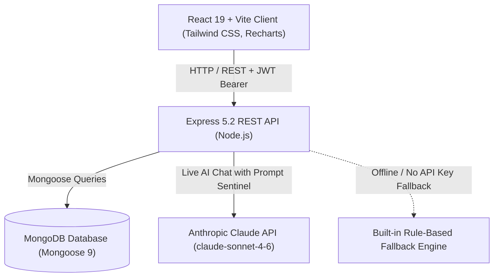

# HealthBridge — AI-Powered Preventive Healthcare & Clinical Consultation Platform

[](https://react.dev/)
[](https://vitejs.dev/)
[](https://nodejs.org/)
[](https://expressjs.com/)
[](https://www.mongodb.com/)
[](https://tailwindcss.com/)
[](https://anthropic.com/)

HealthBridge is a full-stack MERN healthcare application that bridges the gap between everyday preventive lifestyle care and professional clinical consultations. It combines automated biometric wellness scoring, personalized adaptive health education, conversational AI symptom triage with emergency red flag detection, and end-to-end doctor appointment scheduling.

---

## Table of Contents

- [System Architecture](#system-architecture)
- [Core Features](#core-features)
  - [Patient Experience](#patient-experience)
  - [Doctor Experience](#doctor-experience)
  - [AI & Wellness Intelligence Engine](#ai--wellness-intelligence-engine)
- [Technology Stack](#technology-stack)
- [Project Directory Structure](#project-directory-structure)
- [REST API Reference](#rest-api-reference)
- [Getting Started](#getting-started)
  - [Prerequisites](#prerequisites)
  - [1. Backend Setup](#1-backend-setup)
  - [2. Frontend Setup](#2-frontend-setup)
  - [3. Database Seeding & Demo Credentials](#3-database-seeding--demo-credentials)
- [Environment Variables](#environment-variables)
- [Production Build](#production-build)
- [Medical Safety & AI Disclaimer](#medical-safety--ai-disclaimer)

---

## System Architecture



---

## Core Features

### Patient Experience
- **Personalized Health Profile:** Log vitals (height, weight, blood pressure indicators, blood group), lifestyle habits (sleep hours, daily water intake, exercise frequency, diet type, smoking/alcohol status), current medications, allergies, and emergency contact details.
- **5-Dimension Wellness Assessment:** Algorithmic calculation evaluating Nutrition, Physical Activity, Sleep, Mental Well-being, and Substance Risk into an aggregate score (0–100) with risk tiers (`Excellent`, `Good`, `Needs Attention`, `High Priority`) and tailored clinical recommendations.
- **AI Health Assistant:** Real-time conversational assistant to help patients organize symptoms and prepare for medical visits. Features automatic emergency keyword detection (e.g., chest pain, shortness of breath, anaphylaxis) that triggers immediate emergency escalation notices.
- **Personalized Adaptive Learning Path:** Dynamically generates interactive micro-modules tailored specifically to deficits identified in the patient's wellness assessment, complete with comprehension quizzes that award wellness points.
- **Education Hub:** Searchable health library categorized across balanced nutrition, physical activity, sleep hygiene, mental resilience, and preventive screenings.
- **Doctor Directory & Booking:** Search licensed physicians by specialty, experience, and hospital affiliation. Interactive booking modal handles real-time slot conflicts.
- **My Appointments Portal:** Filter and manage appointments by status (`pending`, `confirmed`, `completed`, `cancelled`), with options to add patient consultation notes or cancel pending visits.
- **Health Progress & Timeline:** Interactive Recharts visualizers tracking wellness score improvements over time and educational completion status.

### Doctor Experience
- **Clinical Dashboard:** Daily metrics showing total treated patients, pending consultation requests, confirmed appointments, and today's schedule at a glance.
- **Appointment Management Workflow:** Real-time appointment review interface allowing physicians to accept/confirm, decline, or mark appointments as completed.
- **Clinical Consultation Notes:** Doctors can record official clinical notes, diagnoses, and follow-up advice directly onto the appointment record.
- **Patient Directory:** Instant access to the list of unique patients consulted, their contact details, and past appointment history.
- **Doctor Profile Settings:** Manage professional credentials, hospital affiliation, medical registration number, and contact details.

### AI & Wellness Intelligence Engine
- **Dual-Engine Design:** If `ANTHROPIC_API_KEY` is provided in `server/.env`, HealthBridge connects directly to Anthropic's Claude (`claude-sonnet-4-6`) with specialized clinical safety system prompts. If no key is set or the API is unreachable, the system transparently falls back to an offline rule-based expert engine without crashing.
- **Emergency Keyword Sentinel:** Scans user messages for critical red flags (chest pain, breathing distress, stroke signs, severe hemorrhage, etc.) and halts routine conversational flow in favor of urgent emergency medical directions.
- **Dynamic Curriculum Generator:** Inspects individual wellness category scores to generate prioritized learning pathways aimed at resolving specific lifestyle risk areas.

---

## Technology Stack

| Layer | Technologies |
| :--- | :--- |
| **Frontend** | React 19, Vite 8, React Router v7, Tailwind CSS v3, Recharts, Lucide React, Axios |
| **Backend** | Node.js 18+, Express 5.2, Mongoose 9.9, JSON Web Tokens (JWT), bcryptjs, Cors, Dotenv |
| **Database** | MongoDB (Local instance or MongoDB Atlas cluster) |
| **AI Integration** | Anthropic Claude API (`claude-sonnet-4-6`) + Embedded Offline Rule-Based Fallback Engine |
| **Tooling & Linting** | Oxlint, Nodemon, PostCSS, Autoprefixer |

---

## Project Directory Structure

```
Healthbridge/
├── client/                     # React 19 Frontend (Vite)
│   ├── public/                 # Static assets
│   ├── src/
│   │   ├── components/         # Reusable UI (DashboardShell, StatCard, EmptyState, Loader, ProtectedRoute)
│   │   ├── context/            # AuthContext (JWT & user state management)
│   │   ├── layouts/            # PatientLayout and DoctorLayout shells
│   │   ├── pages/
│   │   │   ├── doctor/         # DoctorDashboard, DoctorAppointments, DoctorPatients, DoctorSettings
│   │   │   ├── patient/        # PatientDashboard, Health, AIAssistant, Appointments,
│   │   │   │                   # MyAppointments, DoctorProfile, Wellness, LearningPath,
│   │   │   │                   # Education, Progress, Settings
│   │   │   ├── Home.jsx        # Landing page
│   │   │   ├── Login.jsx       # Universal login
│   │   │   ├── Register.jsx    # Dual-role signup (Patient / Doctor)
│   │   │   ├── Unauthorized.jsx# 403 Forbidden handler
│   │   │   └── NotFound.jsx    # 404 page
│   │   ├── services/           # Axios API modules (api, auth, appointments, ai, health, wellness, etc.)
│   │   ├── App.jsx             # Route definitions & Role-based access control
│   │   ├── main.jsx            # React root mount
│   │   └── index.css           # Tailwind CSS directives & global styling
│   ├── .env.example            # Sample client environment configuration
│   ├── package.json            # Client scripts & dependencies
│   ├── tailwind.config.js      # Tailwind design configuration
│   └── vite.config.js          # Vite build configuration
│
├── server/                     # Express Backend & MongoDB Models
│   ├── controllers/            # Route controllers (auth, appointment, ai, doctor, health, wellness, etc.)
│   ├── data/                   # Educational library and health curriculum data
│   ├── middleware/             # authMiddleware (JWT verification), roleMiddleware (RBAC)
│   ├── models/                 # Mongoose schemas:
│   │   ├── User.js             # Patient & Doctor profiles, credentials, registration details
│   │   ├── HealthProfile.js    # Vitals, biometrics, lifestyle factors, medical history
│   │   ├── WellnessAssessment.js# Categorical scores, priority areas, actionable recommendations
│   │   ├── LearningPath.js     # Adaptive modules, lessons, quizzes, points earned
│   │   ├── Appointment.js      # Booking lifecycle, doctor notes, consultation summaries
│   │   └── AIConversation.js   # Chat history, triage tags, red flags
│   ├── routes/                 # Express API route endpoints
│   ├── services/
│   │   └── aiService.js        # Claude Sonnet integration, emergency filter, rule-based fallback
│   ├── utils/
│   │   ├── wellnessEngine.js   # 5-dimension scoring and tiering algorithms
│   │   └── learningPathGenerator.js # Custom curriculum generator based on wellness metrics
│   ├── .env.example            # Sample server environment configuration
│   ├── package.json            # Server scripts & dependencies
│   ├── seed.js                 # Database seeder with demo doctors, patient, and assessments
│   └── server.js               # Express application entry point & MongoDB connection
│
├── .gitignore                  # Git ignore rules
└── README.md                   # Project documentation
```

---

## REST API Reference

All protected endpoints require an `Authorization: Bearer <JWT_TOKEN>` header, which the client attaches automatically via Axios interceptors.

### Authentication & Users
| Method | Endpoint | Access | Description |
| :--- | :--- | :--- | :--- |
| `POST` | `/api/auth/register` | Public | Register a new user (`patient` or `doctor`) |
| `POST` | `/api/auth/login` | Public | Authenticate user and receive JWT + user payload |
| `GET` | `/api/users/profile` | Protected | Get authenticated user's profile |
| `PATCH` | `/api/users/profile` | Protected | Update authenticated user's profile details |

### Health Profile & Wellness Engine
| Method | Endpoint | Role | Description |
| :--- | :--- | :--- | :--- |
| `GET` | `/api/health/profile` | Patient | Fetch patient's vitals, lifestyle habits, and history |
| `POST` | `/api/health/profile` | Patient | Create or update health profile & compute BMI |
| `POST` | `/api/wellness/assessment` | Patient | Run wellness scoring engine and persist results |
| `GET` | `/api/wellness/assessment/latest` | Patient | Retrieve patient's latest wellness assessment |

### AI Health Assistant
| Method | Endpoint | Role | Description |
| :--- | :--- | :--- | :--- |
| `POST` | `/api/ai/conversation` | Patient | Initialize a new conversational session |
| `POST` | `/api/ai/conversation/:id/message` | Patient | Submit message; triggers Claude AI or offline fallback |
| `GET` | `/api/ai/conversation/:id` | Patient | Retrieve conversation message history & triage status |

### Education & Adaptive Learning Paths
| Method | Endpoint | Role | Description |
| :--- | :--- | :--- | :--- |
| `GET` | `/api/learning/library` | Patient | Browse entire educational knowledge base |
| `GET` | `/api/learning` | Patient | Fetch patient's active personalized learning path |
| `POST` | `/api/learning/generate` | Patient | Generate tailored path from latest wellness assessment |
| `PATCH` | `/api/learning/:id/module/:moduleId` | Patient | Update completion status of a module |
| `POST` | `/api/learning/:id/module/:moduleId/lesson/:lessonId/quiz` | Patient | Submit quiz answers, compute score, and award points |

### Doctor Discovery & Appointments
| Method | Endpoint | Role | Description |
| :--- | :--- | :--- | :--- |
| `GET` | `/api/doctors` | Patient | Search and filter licensed doctors |
| `GET` | `/api/doctors/:id` | Patient | Get public profile details for a specific doctor |
| `GET` | `/api/doctors/me/patients` | Doctor | Fetch list of patients treated by logged-in doctor |
| `GET` | `/api/doctors/me/stats` | Doctor | Get doctor dashboard summary statistics |
| `POST` | `/api/appointments` | Patient | Book appointment slot with a doctor |
| `GET` | `/api/appointments/patient` | Patient | List patient's appointments |
| `PATCH` | `/api/appointments/:id/cancel` | Patient | Cancel a booked appointment |
| `GET` | `/api/appointments/doctor` | Doctor | List appointments assigned to the logged-in doctor |
| `PATCH` | `/api/appointments/:id/status` | Doctor | Update status (`confirmed`, `rejected`, `completed`) + clinical notes |

### Dashboard & Timeline
| Method | Endpoint | Role | Description |
| :--- | :--- | :--- | :--- |
| `GET` | `/api/dashboard/patient` | Patient | Aggregated patient dashboard data (vitals, score, visits) |
| `GET` | `/api/timeline` | Patient | Chronological timeline of assessments and consultations |

---

## Getting Started

### Prerequisites

- **Node.js**: v18.0.0 or higher
- **npm**: v9.0.0 or higher
- **MongoDB**: A running local MongoDB instance (`mongodb://localhost:27017`) or a free [MongoDB Atlas](https://www.mongodb.com/atlas) cluster URI.

---

### 1. Backend Setup

1. Open a terminal and navigate to the `server` directory:
   ```bash
   cd server
   ```

2. Install dependencies:
   ```bash
   npm install
   ```

3. Create the environment file from the template:
   - **Linux / macOS:**
     ```bash
     cp .env.example .env
     ```
   - **Windows (PowerShell):**
     ```powershell
     Copy-Item .env.example .env
     ```

4. Configure your `.env` file:
   ```env
   PORT=5000
   MONGO_URI=mongodb://localhost:27017/healthbridge
   JWT_SECRET=your_super_secret_jwt_key_here
   ANTHROPIC_API_KEY=   # (Optional) Add your key to enable live Claude AI responses
   ```

5. Seed demo data (recommended for first run):
   ```bash
   npm run seed
   ```

6. Start the API server:
   ```bash
   npm run dev
   ```
   *The API will start at `http://localhost:5000`.*

---

### 2. Frontend Setup

1. Open a second terminal and navigate to the `client` directory:
   ```bash
   cd client
   ```

2. Install dependencies:
   ```bash
   npm install
   ```

3. Create the environment file from the template:
   - **Linux / macOS:**
     ```bash
     cp .env.example .env
     ```
   - **Windows (PowerShell):**
     ```powershell
     Copy-Item .env.example .env
     ```

4. Verify `client/.env`:
   ```env
   VITE_API_URL=http://localhost:5000/api
   ```

5. Launch the Vite development server:
   ```bash
   npm run dev
   ```
   *The frontend will run at `http://localhost:5173`.*

---

### 3. Database Seeding & Demo Credentials

Running `npm run seed` in the `server` directory initializes the database with a pre-configured patient profile, wellness metrics, customized learning path, appointments, and 4 doctors across different medical specialties.

All demo accounts share the password: **`Password123!`**

| Account Role | Name | Specialty / Details | Demo Email | Password |
| :--- | :--- | :--- | :--- | :--- |
| **Patient** | Aditi Sharma | Completed profile, assessment & history | `patient@healthbridge.demo` | `Password123!` |
| **Doctor** | Dr. Ananya Rao | Cardiologist (Sunrise Heart Institute) | `dr.ananya@healthbridge.demo` | `Password123!` |
| **Doctor** | Dr. Rahul Mehta | General Physician (City Care Clinic) | `dr.rahul@healthbridge.demo` | `Password123!` |
| **Doctor** | Dr. Priya Nair | Dermatologist (Glow Skin & Wellness) | `dr.priya@healthbridge.demo` | `Password123!` |
| **Doctor** | Dr. Vikram Singh | Orthopedic (Metro Bone & Joint Center) | `dr.vikram@healthbridge.demo` | `Password123!` |

> [!TIP]
> You can also register new doctor and patient accounts at any time via the `/register` page.

---

## Environment Variables

### Server (`server/.env`)
| Variable | Required | Default | Description |
| :--- | :---: | :--- | :--- |
| `PORT` | No | `5000` | Port for the Express server to listen on |
| `MONGO_URI` | **Yes** | — | MongoDB connection string (local or MongoDB Atlas) |
| `JWT_SECRET` | **Yes** | — | Cryptographic secret key used to sign and verify JWTs |
| `ANTHROPIC_API_KEY` | No | *Empty* | Anthropic API key. When blank, the app uses the offline AI engine |

### Client (`client/.env`)
| Variable | Required | Default | Description |
| :--- | :---: | :--- | :--- |
| `VITE_API_URL` | No | `http://localhost:5000/api` | Base URL pointing to the backend API |

---

## Production Build

To build the client application for production deployment:

```bash
cd client
npm run build
```

The optimized static assets will be output to `client/dist/`. These files can be served using Nginx, Apache, Caddy, Vercel, Netlify, or directly via Express static middleware.

To preview the production build locally:
```bash
npm run preview
```

---

## Medical Safety & AI Disclaimer

> [!WARNING]
> **HealthBridge is an educational and supportive health management platform, NOT a certified diagnostic medical device.**
> 
> - The AI Health Assistant does **not** provide clinical medical diagnoses, prescribe medications, or replace direct consultation with a qualified medical professional.
> - In situations involving emergency symptoms—including, but not limited to, acute chest pain, breathing difficulties, stroke symptoms, loss of consciousness, or severe trauma—users should **immediately contact emergency medical services** (e.g., 911 in the US, 112 in India/EU) or proceed to the nearest emergency room.
a