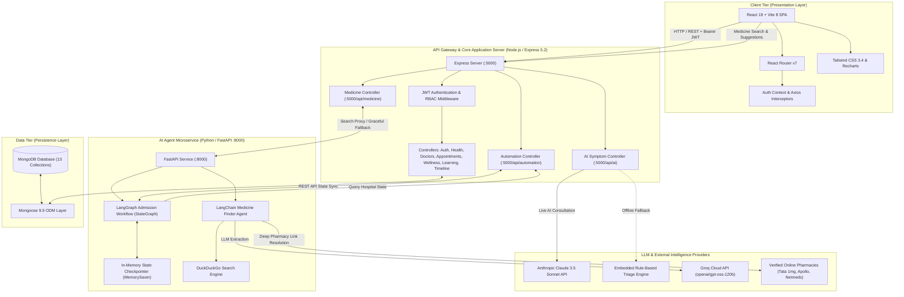
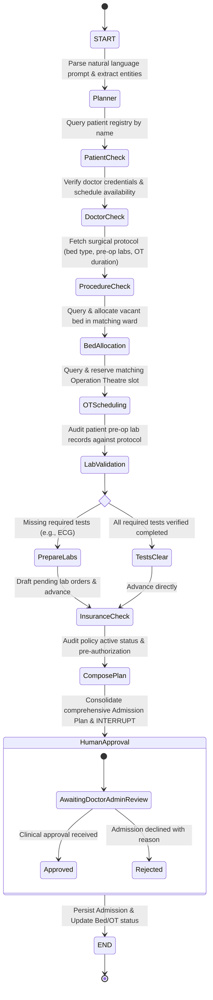
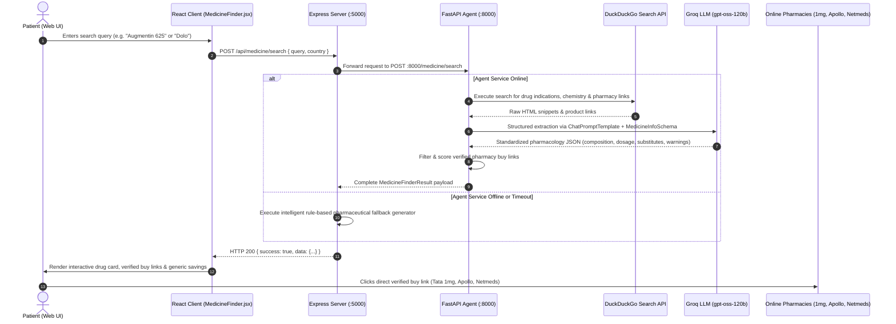
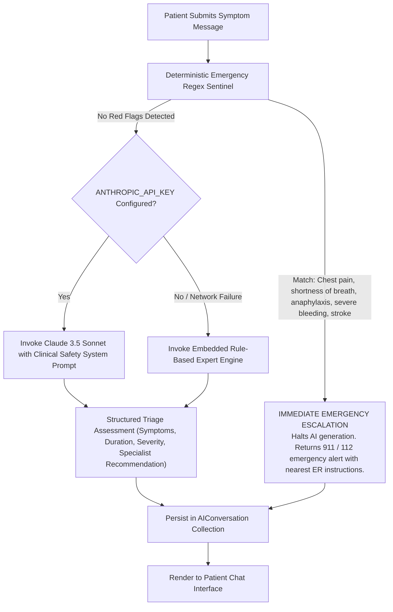

# HealthBridge — AI-Powered Preventive Healthcare, Clinical Consultation & Hospital Operations Platform

[](https://react.dev/)
[](https://vitejs.dev/)
[](https://nodejs.org/)
[](https://expressjs.com/)
[](https://www.mongodb.com/)
[](https://www.python.org/)
[](https://fastapi.tiangolo.com/)
[](https://www.langchain.com/langgraph)
[](https://www.langchain.com/)
[](https://groq.com/)
[](https://anthropic.com/)
[](https://tailwindcss.com/)

HealthBridge is an enterprise-grade full-stack healthcare ecosystem that bridges the gap between everyday preventive lifestyle wellness, clinical doctor consultations, and autonomous hospital inpatient operations. It combines algorithmic biometric scoring, personalized adaptive medical curricula, real-time AI symptom triage with an emergency red-flag sentinel, doctor scheduling, an autonomous multi-node hospital admission orchestration agent built on **LangGraph**, and a live online medicine intelligence engine powered by **LangChain**, **DuckDuckGo**, and **Groq**.

---

## Table of Contents

- [Platform Overview](#platform-overview)
- [System Design Architecture](#system-design-architecture)
  - [High-Level Multi-Tier Architecture](#high-level-multi-tier-architecture)
  - [Subsystem 1: Autonomous Clinical Admission Pipeline (LangGraph)](#subsystem-1-autonomous-clinical-admission-pipeline-langgraph)
  - [Subsystem 2: AI Medicine Finder & Online Pharmacy Intelligence (LangChain)](#subsystem-2-ai-medicine-finder--online-pharmacy-intelligence-langchain)
  - [Subsystem 3: AI Symptom Triage & Red-Flag Sentinel](#subsystem-3-ai-symptom-triage--red-flag-sentinel)
  - [Subsystem 4: Preventive Health & 5-Dimension Wellness Scoring](#subsystem-4-preventive-health--5-dimension-wellness-scoring)
  - [Subsystem 5: Security & Role-Based Access Control (RBAC)](#subsystem-5-security--role-based-access-control-rbac)
- [Database Tables Architecture (Data Model)](#database-tables-architecture-data-model)
  - [Entity-Relationship Diagram (ERD)](#entity-relationship-diagram-erd)
  - [Schema Dictionary & Table Specifications](#schema-dictionary--table-specifications)
    - [1. Users Collection (`users`)](#1-users-collection-users)
    - [2. Health Profile Collection (`healthprofiles`)](#2-health-profile-collection-healthprofiles)
    - [3. Wellness Assessment Collection (`wellnessassessments`)](#3-wellness-assessment-collection-wellnessassessments)
    - [4. Learning Path Collection (`learningpaths`)](#4-learning-path-collection-learningpaths)
    - [5. Appointment Collection (`appointments`)](#5-appointment-collection-appointments)
    - [6. AI Conversation Collection (`aiconversations`)](#6-ai-conversation-collection-aiconversations)
    - [7. Admission Collection (`admissions`)](#7-admission-collection-admissions)
    - [8. Agent Run Collection (`agentruns`)](#8-agent-run-collection-agentruns)
    - [9. Hospital Bed Collection (`beds`)](#9-hospital-bed-collection-beds)
    - [10. Operation Theatre Collection (`operationtheatres`)](#10-operation-theatre-collection-operationtheatres)
    - [11. Procedure Protocol Collection (`procedureprotocols`)](#11-procedure-protocol-collection-procedureprotocols)
    - [12. Lab Order Collection (`laborders`)](#12-lab-order-collection-laborders)
    - [13. Insurance Collection (`insurances`)](#13-insurance-collection-insurances)
  - [Indexing & Relational Integrity Strategy](#indexing--relational-integrity-strategy)
- [Core Features](#core-features)
  - [Patient Experience](#patient-experience)
  - [Doctor Experience](#doctor-experience)
  - [Autonomous Hospital Operations & Admission Agent](#autonomous-hospital-operations--admission-agent)
  - [AI Medicine Finder & Price Comparison](#ai-medicine-finder--price-comparison)
- [Technology Stack](#technology-stack)
- [Project Directory Structure](#project-directory-structure)
- [REST API Reference](#rest-api-reference)
  - [Express Backend Endpoints](#express-backend-endpoints)
  - [Python Agent Microservice Endpoints](#python-agent-microservice-endpoints)
- [Getting Started](#getting-started)
  - [Prerequisites](#prerequisites)
  - [1. Backend Setup (`server`)](#1-backend-setup-server)
  - [2. AI Agent Microservice Setup (`agent-service`)](#2-ai-agent-microservice-setup-agent-service)
  - [3. Frontend Setup (`client`)](#3-frontend-setup-client)
  - [4. Database Seeding & Demo Credentials](#4-database-seeding--demo-credentials)
- [Environment Variables](#environment-variables)
- [Production Deployment](#production-deployment)
- [Medical Safety & AI Disclaimer](#medical-safety--ai-disclaimer)

---

## Platform Overview

HealthBridge operates across three interconnected functional spheres:

1. **Preventive Wellness & Adaptive Health Intelligence**: Patients track vitals, calculate a 5-dimension wellness score (Nutrition, Physical Activity, Sleep, Mental Health, Substance Risk), and receive personalized learning paths with interactive quizzes.
2. **Clinical Consultations & Care Coordination**: Patients discover accredited physicians, schedule time slots, and manage appointments while doctors review clinical histories, accept/reject consultations, and record official clinical diagnoses.
3. **Autonomous Inpatient Operations & Pharmacological Intelligence**:
   - A multi-step **LangGraph Agent** orchestrates hospital admissions: extracts admission requirements from natural language, verifies doctor availability, checks surgical protocols, allocates ward beds, reserves operation theatres (OTs), validates pre-operative lab orders (auto-drafting missing tests), and confirms insurance pre-authorization with human-in-the-loop clinical approval.
   - A **LangChain + DuckDuckGo + Groq** medicine agent searches verified online pharmacies (Tata 1mg, Apollo Pharmacy, Netmeds, PharmEasy), parses active salts, indications, dosage forms, side effects, precautions, and presents cost-saving generic alternatives.

---

## System Design Architecture

### High-Level Multi-Tier Architecture

The platform follows a decoupled, resilient microservices-oriented architecture:



---

### Subsystem 1: Autonomous Clinical Admission Pipeline (LangGraph)

The admission agent transforms unstructured admission orders (e.g., *"Admit Aditi Sharma under Dr. Vikram Singh for Knee Replacement tomorrow"*) into fully validated inpatient admissions.



#### Pipeline Step Breakdown

| Node | Action Performed | Automation Endpoint Called | Fallback / Error Handling |
| :--- | :--- | :--- | :--- |
| **`planner`** | Extracts `patient_name`, `doctor_name`, `procedure_code`, `requested_date` using regex and heuristics. | — | Appends parsing error to state error list. |
| **`patient`** | Verifies patient exists in database and resolves ObjectId. | `GET /api/automation/patient/search?name={name}` | Halts downstream clinical checks if patient not found. |
| **`doctor`** | Checks doctor existence, active appointments, and daily slot conflicts. | `GET /api/automation/doctor/availability?doctorName={name}&date={date}` | Marks doctor unavailable if conflicting appointments exist. |
| **`procedure`** | Retrieves clinical protocol: required bed ward, required pre-op lab panel, and OT duration in minutes. | `GET /api/automation/procedure/{code}` | Validates procedure code against catalog (e.g., `KNEE_REPLACEMENT`). |
| **`bed`** | Scans hospital beds for matching ward (`orthopedic`, `icu`, `general`) and status `available`. | `GET /api/automation/beds/available?ward={ward}` | Flags shortage if no beds available. |
| **`ot`** | Finds Operation Theatres supporting the procedure with unreserved slots matching duration. | `GET /api/automation/ots/available?procedure={code}&date={date}` | Selects first available slot matching target date. |
| **`labs`** | Compares patient completed lab tests against protocol required tests. | `GET /api/automation/labs/patient/{patientId}` | Identifies missing mandatory tests. |
| **`prepare_labs`** | Automatically drafts pending lab orders for any missing diagnostic tests. | Internal state update | Appends missing tests to draft list for clinical follow-up. |
| **`insurance`** | Audits policy status, total coverage amount, and pre-authorization requirement. | `GET /api/automation/insurance/{patientId}` | Flags whether insurance pre-authorization is approved or pending. |
| **`plan`** | Synthesizes bed, OT, doctor, lab, and insurance verification into a unified admission plan. | Internal state compilation | Emits unified structured admission summary. |
| **`approval`** | Triggers LangGraph `interrupt()` pause. Halts execution until a clinician reviews and submits `approve` or `reject`. | `POST /admission/approve` (resumes with `Command(resume=...)`) | Persists state in `MemorySaver` checkpointer. |

---

### Subsystem 2: AI Medicine Finder & Online Pharmacy Intelligence (LangChain)



---

### Subsystem 3: AI Symptom Triage & Red-Flag Sentinel

To ensure medical safety, HealthBridge implements a multi-layer emergency detection pipeline:



---

### Subsystem 4: Preventive Health & 5-Dimension Wellness Scoring

The platform computes wellness through an algorithmic, deterministic weighted scoring engine:

$$\text{Wellness Score} = \sum_{i=1}^{5} w_i \cdot S_i$$

Where categories $S_i \in [0, 100]$:
1. **Nutrition ($w = 0.20$)**: Evaluates daily water intake (target $\ge 2.5\text{L}$), dietary balance (Vegetarian, Vegan, Non-Vegetarian), and caloric balance.
2. **Physical Activity ($w = 0.25$)**: Assesses weekly workout frequency ($0$, $1\text{--}2$, $3\text{--}4$, $5+\text{ days}$) and BMI calculation from height and weight.
3. **Sleep Hygiene ($w = 0.20$)**: Scores restorative sleep hours (optimal range $7\text{--}9\text{ hours}$).
4. **Mental Well-being ($w = 0.20$)**: Evaluates self-reported stress levels (Low, Moderate, High) and mood indicators.
5. **Substance Risk ($w = 0.15$)**: Penalizes tobacco and alcohol consumption frequency (Never, Occasionally, Regularly).

The aggregate score is mapped to risk tiers:
- **$85\text{--}100$**: `Excellent` — Maintenance and optimal performance.
- **$70\text{--}84$**: `Good` — Minor lifestyle adjustments.
- **$50\text{--}69$**: `Needs Attention` — Targeted intervention required.
- **$< 50$**: `High Priority` — Immediate lifestyle intervention and clinical consultation suggested.

Based on categorical score deficits, the system automatically builds a customized **Learning Path** with interactive micro-modules and comprehension quizzes.

---

### Subsystem 5: Security & Role-Based Access Control (RBAC)

- **Authentication**: Stateless authentication using JSON Web Tokens (JWT) signed with HMAC-SHA256, carrying user `id` and `role`.
- **Password Hashing**: Passwords are salted with 10 rounds of `bcryptjs` before database persistence.
- **Role Verification**: Middleware (`authMiddleware.js` and `roleMiddleware.js`) guards all protected routes:
  - Role `patient`: Authorized for personal health profiles, wellness assessments, booking appointments, and learning modules.
  - Role `doctor`: Authorized for clinical dashboards, reviewing assigned appointments, updating statuses (`confirmed`, `rejected`, `completed`), and authoring clinical consultation notes.
- **Input Sanitization**: Express request bodies are trimmed and validated; MongoDB object IDs are validated to prevent NoSQL injection.

---

## Database Tables Architecture (Data Model)

HealthBridge uses a comprehensive schema model consisting of **13 interconnected collections** managed via Mongoose 9.9.

### Entity-Relationship Diagram (ERD)

```mermaid
erDiagram
    User ||--o| HealthProfile : "has profile (1:1)"
    User ||--o{ WellnessAssessment : "undergoes (1:N)"
    User ||--o{ LearningPath : "completes (1:N)"
    User ||--o{ Appointment : "books as patient (1:N)"
    User ||--o{ Appointment : "assigned as doctor (1:N)"
    User ||--o{ AIConversation : "participates in (1:N)"
    User ||--o{ Admission : "admitted as patient (1:N)"
    User ||--o{ Admission : "supervises as doctor (1:N)"
    User ||--o{ AgentRun : "initiates (1:N)"
    User ||--o{ LabOrder : "receives as patient (1:N)"
    User ||--o{ LabOrder : "orders as doctor (1:N)"
    User ||--o| Insurance : "holds policy (1:1)"
    User ||--o| Bed : "currently occupies (1:1)"

    HealthProfile ||--o{ WellnessAssessment : "informs scoring"
    WellnessAssessment ||--o| LearningPath : "generates curriculum"

    Bed ||--o{ Admission : "allocated to"
    OperationTheatre ||--o{ Admission : "reserved for"
    LabOrder }o--o{ Admission : "required by"
    AgentRun ||--o| Admission : "creates upon approval"

    User {
        ObjectId _id PK
        string name
        string email UK
        string password
        string role "patient | doctor"
        string phone
        date dateOfBirth
        string gender "male | female | other"
        string specialization
        number experience
        string medicalRegistrationNumber
        string hospital
        date createdAt
        date updatedAt
    }

    HealthProfile {
        ObjectId _id PK
        ObjectId patient FK,UK "ref User"
        number height
        number weight
        string bloodGroup "A+ | A- | B+ | B- | AB+ | AB- | O+ | O- | Unknown"
        string exerciseFrequency "Never | 1-2 days | 3-4 days | 5+ days"
        number sleepHours
        number waterIntake
        string dietType "Vegetarian | Non-Vegetarian | Vegan | Other"
        string smoking "Never | Occasionally | Regularly"
        string alcohol "Never | Occasionally | Regularly"
        stringArray existingConditions
        stringArray allergies
        stringArray currentMedications
        stringArray previousSurgeries
        stringArray familyMedicalHistory
        string stressLevel "Low | Moderate | High"
        string mood "Excellent | Good | Okay | Low | Very Low"
        number profileCompletion
        date createdAt
        date updatedAt
    }

    WellnessAssessment {
        ObjectId _id PK
        ObjectId patient FK "ref User"
        ObjectId healthProfile FK "ref HealthProfile"
        number overallScore "0 to 100"
        object categories "nutrition, physicalActivity, sleep, mentalWellbeing, substanceRisk"
        stringArray priorityAreas
        stringArray recommendations
        date createdAt
        date updatedAt
    }

    LearningPath {
        ObjectId _id PK
        ObjectId patient FK "ref User"
        ObjectId assessment FK "ref WellnessAssessment"
        array modules "Embedded array of learning modules & lessons"
        number overallProgress "0 to 100"
        number points
        number completedLessons
        number streak
        date createdAt
        date updatedAt
    }

    Appointment {
        ObjectId _id PK
        ObjectId patient FK "ref User"
        ObjectId doctor FK "ref User"
        string date "YYYY-MM-DD"
        string time "HH:mm"
        string reason
        string status "pending | confirmed | rejected | completed | cancelled"
        string doctorNotes
        string patientNotes
        string aiConsultationSummary
        date createdAt
        date updatedAt
    }

    AIConversation {
        ObjectId _id PK
        ObjectId patient FK "ref User"
        array messages "Embedded array: role, content, createdAt"
        object consultationSummary "concern, symptoms, duration, severity, additionalInfo"
        boolean requiresDoctor
        stringArray redFlags
        date createdAt
        date updatedAt
    }

    Admission {
        ObjectId _id PK
        ObjectId patient FK "ref User"
        ObjectId doctor FK "ref User"
        string procedure
        string status "pending | planned | approved | admitted | completed | cancelled"
        date date
        ObjectId bed FK "ref Bed"
        ObjectId OT FK "ref OperationTheatre"
        date OTTime
        array labOrders "Array of ref LabOrder"
        string insuranceStatus "pending | approved | denied"
        date createdAt
        date updatedAt
    }

    AgentRun {
        ObjectId _id PK
        ObjectId initiatedBy FK "ref User"
        string userRequest
        ObjectId patient FK "ref User"
        ObjectId doctor FK "ref User"
        string procedureCode
        date requestedDate
        string currentStep "Enum: started .. completed | rejected | failed"
        string status "running | awaiting_approval | approved | rejected | completed | failed"
        object plan "Embedded admission plan summary"
        object approval "status, approvedBy, approvedAt, rejectionReason"
        array logs "Embedded step logs"
        array errors "Embedded execution errors"
        ObjectId admission FK "ref Admission"
        date startedAt
        date completedAt
        date createdAt
        date updatedAt
    }

    Bed {
        ObjectId _id PK
        string bedNumber UK
        string ward "orthopedic | icu | general | cardiology"
        string status "available | occupied | maintenance"
        ObjectId currentPatient FK "ref User"
        date createdAt
        date updatedAt
    }

    OperationTheatre {
        ObjectId _id PK
        string OTName UK
        stringArray supportedProcedures
        array slots "Embedded slots: date, startTime, endTime, status, reservedFor"
        date createdAt
        date updatedAt
    }

    ProcedureProtocol {
        ObjectId _id PK
        string code UK
        string department
        string requiredBedType
        stringArray requiredTests
        number otDurationMinutes
        date createdAt
        date updatedAt
    }

    LabOrder {
        ObjectId _id PK
        ObjectId patient FK "ref User"
        string testName
        string status "pending | completed | cancelled"
        string result
        ObjectId requestedBy FK "ref User"
        date createdAt
        date updatedAt
    }

    Insurance {
        ObjectId _id PK
        ObjectId patient FK,UK "ref User"
        string provider
        string status "active | inactive | expired"
        number coverage
        boolean preAuthorizationRequired
        string preAuthorizationStatus "pending | approved | denied"
        date createdAt
        date updatedAt
    }
```



---

### Schema Dictionary & Table Specifications

#### 1. Users Collection (`users`)
Stores identity, role credentials, and professional licensing profiles for both patients and doctors.

| Field Name | Type | Constraints | Default | Reference / Details |
| :--- | :--- | :--- | :---: | :--- |
| `_id` | `ObjectId` | Primary Key | Auto | Unique user record identifier |
| `name` | `String` | Required, Trimmed | — | Full name of patient or medical professional |
| `email` | `String` | Required, Unique, Lowercase | — | Primary login credential |
| `password` | `String` | Required | — | Salted bcrypt hash ($10$ rounds) |
| `role` | `String` | Required, Enum: `['patient', 'doctor']` | `'patient'` | Determines authorization scope in RBAC |
| `phone` | `String` | Optional | `null` | Contact telephone number |
| `dateOfBirth` | `Date` | Optional | `null` | Patient date of birth |
| `gender` | `String` | Enum: `['male', 'female', 'other']` | `null` | Gender identification |
| `specialization`| `String` | Optional (Doctor only) | `null` | Medical specialty (e.g., Cardiologist, Orthopedic) |
| `experience` | `Number` | Optional (Doctor only) | `null` | Years of clinical practice |
| `medicalRegistrationNumber` | `String` | Optional (Doctor only) | `null` | Medical council registration code |
| `hospital` | `String` | Optional (Doctor only) | `null` | Affiliated clinic or healthcare facility |
| `createdAt` / `updatedAt` | `Date` | Timestamps | Auto | Audit tracking timestamps |

---

#### 2. Health Profile Collection (`healthprofiles`)
Maintains biometrics, lifestyle factors, allergies, and ongoing medications.

| Field Name | Type | Constraints | Default | Reference / Details |
| :--- | :--- | :--- | :---: | :--- |
| `_id` | `ObjectId` | Primary Key | Auto | Record ID |
| `patient` | `ObjectId` | Required, Unique | — | Foreign Key $\to$ `User._id` (1:1 with patient) |
| `height` | `Number` | Optional | `null` | Height in centimeters (cm) |
| `weight` | `Number` | Optional | `null` | Weight in kilograms (kg) |
| `bloodGroup` | `String` | Enum: `['A+', 'A-', 'B+', 'B-', 'AB+', 'AB-', 'O+', 'O-', 'Unknown']` | `'Unknown'` | Blood classification |
| `exerciseFrequency` | `String` | Enum: `['Never', '1-2 days', '3-4 days', '5+ days']` | `null` | Weekly physical exercise activity |
| `sleepHours` | `Number` | Optional | `null` | Average nightly sleep hours |
| `waterIntake` | `Number` | Optional | `null` | Daily hydration intake in Liters (L) |
| `dietType` | `String` | Enum: `['Vegetarian', 'Non-Vegetarian', 'Vegan', 'Other']` | `null` | Primary dietary pattern |
| `smoking` | `String` | Enum: `['Never', 'Occasionally', 'Regularly']` | `'Never'` | Tobacco use frequency |
| `alcohol` | `String` | Enum: `['Never', 'Occasionally', 'Regularly']` | `'Never'` | Alcohol consumption frequency |
| `existingConditions` | `[String]` | Array of Strings | `[]` | Diagnosed chronic conditions (e.g. Hypertension) |
| `allergies` | `[String]` | Array of Strings | `[]` | Known medication or environmental allergies |
| `currentMedications`| `[String]` | Array of Strings | `[]` | Current active prescriptions |
| `previousSurgeries` | `[String]` | Array of Strings | `[]` | Surgical history |
| `familyMedicalHistory`| `[String]` | Array of Strings | `[]` | Hereditary health risks |
| `stressLevel` | `String` | Enum: `['Low', 'Moderate', 'High']` | `'Low'` | Self-reported psychological stress |
| `mood` | `String` | Enum: `['Excellent', 'Good', 'Okay', 'Low', 'Very Low']` | `'Good'` | Daily affective mood state |
| `profileCompletion` | `Number` | Range: `0 - 100` | `0` | Calculated percentage of profile fields completed |
| `createdAt` / `updatedAt` | `Date` | Timestamps | Auto | Audit tracking timestamps |

---

#### 3. Wellness Assessment Collection (`wellnessassessments`)
Records the outputs of the 5-dimension wellness engine.

| Field Name | Type | Constraints | Default | Reference / Details |
| :--- | :--- | :--- | :---: | :--- |
| `_id` | `ObjectId` | Primary Key | Auto | Record ID |
| `patient` | `ObjectId` | Required | — | Foreign Key $\to$ `User._id` |
| `healthProfile` | `ObjectId` | Optional | — | Foreign Key $\to$ `HealthProfile._id` |
| `overallScore` | `Number` | Min: `0`, Max: `100` | `0` | Aggregate wellness index |
| `categories` | `Object` | Nested subdocuments | `{}` | Dimension breakdown: `nutrition`, `physicalActivity`, `sleep`, `mentalWellbeing`, `substanceRisk`. Each containing `score` (Number) and `level` (String). |
| `priorityAreas` | `[String]` | Array of Strings | `[]` | Identified high-risk categories requiring intervention |
| `recommendations` | `[String]` | Array of Strings | `[]` | Clinically formulated lifestyle guidance |
| `createdAt` / `updatedAt` | `Date` | Timestamps | Auto | Date of wellness evaluation |

---

#### 4. Learning Path Collection (`learningpaths`)
Dynamic, gamified educational modules generated in response to wellness deficits.

| Field Name | Type | Constraints | Default | Reference / Details |
| :--- | :--- | :--- | :---: | :--- |
| `_id` | `ObjectId` | Primary Key | Auto | Record ID |
| `patient` | `ObjectId` | Required | — | Foreign Key $\to$ `User._id` |
| `assessment` | `ObjectId` | Optional | — | Foreign Key $\to$ `WellnessAssessment._id` |
| `modules` | `[ModuleSchema]` | Embedded documents | `[]` | Tailored educational curriculum modules |
| `modules.category` | `String` | Required | — | Health domain (e.g. `Sleep Hygiene`, `Nutrition`) |
| `modules.title` | `String` | Required | — | Module heading |
| `modules.priority` | `String` | Enum: `['Low', 'Medium', 'High']` | `'Medium'` | Urgency based on assessment deficits |
| `modules.lessons` | `[LessonSchema]` | Embedded array | `[]` | Lessons containing reading material and quizzes |
| `modules.lessons.questions` | `[QuestionSchema]` | Embedded array | `[]` | Quiz questions: `question`, `options`, `correctAnswer` |
| `overallProgress` | `Number` | Range: `0 - 100` | `0` | Curriculum completion rate percentage |
| `points` | `Number` | Non-negative | `0` | Earned wellness points |
| `completedLessons` | `Number` | Non-negative | `0` | Cumulative finished lesson counter |
| `streak` | `Number` | Non-negative | `0` | Daily continuous learning streak counter |
| `createdAt` / `updatedAt` | `Date` | Timestamps | Auto | Audit tracking timestamps |

---

#### 5. Appointment Collection (`appointments`)
Manages the end-to-end clinical consultation lifecycle between patients and doctors.

| Field Name | Type | Constraints | Default | Reference / Details |
| :--- | :--- | :--- | :---: | :--- |
| `_id` | `ObjectId` | Primary Key | Auto | Record ID |
| `patient` | `ObjectId` | Required | — | Foreign Key $\to$ `User._id` (Patient role) |
| `doctor` | `ObjectId` | Required | — | Foreign Key $\to$ `User._id` (Doctor role) |
| `date` | `String` | Required | — | Scheduled date in format `YYYY-MM-DD` |
| `time` | `String` | Required | — | Consultation time slot in format `HH:mm` |
| `reason` | `String` | Required, Trimmed | — | Patient's primary chief complaint |
| `status` | `String` | Enum: `['pending', 'confirmed', 'rejected', 'completed', 'cancelled']` | `'pending'` | Lifecycle state machine status |
| `doctorNotes` | `String` | Optional | `""` | Clinical diagnosis, prescription, and follow-up advice |
| `patientNotes` | `String` | Optional | `""` | Additional notes or symptoms shared by patient |
| `aiConsultationSummary`| `String`| Optional | `""` | Auto-transferred symptom triage summary from AI assistant |
| `createdAt` / `updatedAt` | `Date` | Timestamps | Auto | Booking creation and status update timestamps |

---

#### 6. AI Conversation Collection (`aiconversations`)
Stores patient conversational triage transcripts and red-flag audits.

| Field Name | Type | Constraints | Default | Reference / Details |
| :--- | :--- | :--- | :---: | :--- |
| `_id` | `ObjectId` | Primary Key | Auto | Record ID |
| `patient` | `ObjectId` | Required | — | Foreign Key $\to$ `User._id` |
| `messages` | `[MessageSchema]`| Array of Objects | `[]` | Full transcript: `role` (`'user'` or `'assistant'`), `content`, `createdAt` |
| `consultationSummary`| `Object` | Embedded document | `{}` | Extracted summary: `concern`, `symptoms`, `duration`, `severity`, `additionalInformation` |
| `requiresDoctor` | `Boolean` | Required | `false` | Set to true if symptoms warrant in-person clinical review |
| `redFlags` | `[String]` | Array of Strings | `[]` | Critical keywords intercepted by sentinel filter |
| `createdAt` / `updatedAt` | `Date` | Timestamps | Auto | Session lifecycle timestamps |

---

#### 7. Admission Collection (`admissions`)
Represents an approved hospital inpatient stay with resource allocations.

| Field Name | Type | Constraints | Default | Reference / Details |
| :--- | :--- | :--- | :---: | :--- |
| `_id` | `ObjectId` | Primary Key | Auto | Record ID |
| `patient` | `ObjectId` | Required | — | Foreign Key $\to$ `User._id` |
| `doctor` | `ObjectId` | Required | — | Foreign Key $\to$ `User._id` |
| `procedure` | `String` | Required | — | Standard procedure code (e.g. `KNEE_REPLACEMENT`) |
| `status` | `String` | Enum: `['pending', 'planned', 'approved', 'admitted', 'completed', 'cancelled']` | `'pending'` | Current admission status |
| `date` | `Date` | Default: `Date.now` | `now` | Scheduled admission date |
| `bed` | `ObjectId` | Optional | `null` | Foreign Key $\to$ `Bed._id` |
| `OT` | `ObjectId` | Optional | `null` | Foreign Key $\to$ `OperationTheatre._id` |
| `OTTime` | `Date` | Optional | `null` | Scheduled start time of surgery in the OT |
| `labOrders` | `[ObjectId]` | Array of ObjectIds | `[]` | Foreign Keys $\to$ `LabOrder._id` |
| `insuranceStatus` | `String` | Enum: `['pending', 'approved', 'denied']` | `'pending'` | Inpatient insurance coverage clearance status |
| `createdAt` / `updatedAt` | `Date` | Timestamps | Auto | Audit tracking timestamps |

---

#### 8. Agent Run Collection (`agentruns`)
Comprehensive audit log of autonomous admission workflow executions.

| Field Name | Type | Constraints | Default | Reference / Details |
| :--- | :--- | :--- | :---: | :--- |
| `_id` | `ObjectId` | Primary Key | Auto | Record ID |
| `initiatedBy` | `ObjectId` | Required | — | Foreign Key $\to$ `User._id` (Doctor or Staff) |
| `userRequest` | `String` | Required, Trimmed | — | Raw natural language input command |
| `patient` | `ObjectId` | Optional | `null` | Foreign Key $\to$ `User._id` |
| `doctor` | `ObjectId` | Optional | `null` | Foreign Key $\to$ `User._id` |
| `procedureCode` | `String` | Optional | `null` | Target procedure identifier |
| `requestedDate` | `Date` | Optional | `null` | Target admission date |
| `currentStep` | `String` | Enum: `15 steps` | `'started'` | Current execution step: `planning`, `patient_lookup`, `bed_check`, `awaiting_approval`, etc. |
| `status` | `String` | Enum: `['running', 'awaiting_approval', 'approved', 'rejected', 'completed', 'failed']` | `'running'` | High-level status of agent run |
| `plan` | `Object` | Embedded Schema | `{}` | Detailed plan snapshot: `patientName`, `doctorName`, `selectedBed`, `selectedOT`, `requiredTests`, `missingTests`, `insurance` |
| `approval` | `Object` | Embedded Schema | `{}` | Human decision audit: `status`, `approvedBy` (ref User), `approvedAt`, `rejectionReason` |
| `logs` | `[LogSchema]` | Embedded array | `[]` | Timestamped step progression messages |
| `errors` | `[ErrorSchema]` | Embedded array | `[]` | Error details encountered during agent execution |
| `admission` | `ObjectId` | Optional | `null` | Foreign Key $\to$ `Admission._id` (created after approval) |
| `startedAt` / `completedAt` | `Date` | Timestamps | — | Execution benchmark timing |

---

#### 9. Hospital Bed Collection (`beds`)
Inpatient bed inventory and availability tracking across hospital wards.

| Field Name | Type | Constraints | Default | Reference / Details |
| :--- | :--- | :--- | :---: | :--- |
| `_id` | `ObjectId` | Primary Key | Auto | Record ID |
| `bedNumber` | `String` | Required, Unique | — | Unique identifier (e.g. `ORTHO-01`, `ICU-02`) |
| `ward` | `String` | Required | — | Ward classification (e.g. `orthopedic`, `icu`, `general`) |
| `status` | `String` | Enum: `['available', 'occupied', 'maintenance']` | `'available'` | Availability indicator |
| `currentPatient` | `ObjectId` | Optional | `null` | Foreign Key $\to$ `User._id` (occupying patient) |
| `createdAt` / `updatedAt` | `Date` | Timestamps | Auto | Inventory audit timestamps |

---

#### 10. Operation Theatre Collection (`operationtheatres`)
Surgical suites with scheduling time slots and supported procedure lists.

| Field Name | Type | Constraints | Default | Reference / Details |
| :--- | :--- | :--- | :---: | :--- |
| `_id` | `ObjectId` | Primary Key | Auto | Record ID |
| `OTName` | `String` | Required, Unique, Trimmed | — | Identifier (e.g. `OT-1`, `OT-2`) |
| `supportedProcedures`| `[String]` | Array of Strings | `[]` | List of procedures executable in this OT |
| `slots` | `[SlotSchema]` | Embedded array | `[]` | Scheduled time windows |
| `slots.date` | `String` | Required | — | Slot date in format `YYYY-MM-DD` |
| `slots.startTime` / `endTime` | `String` | Required | — | Operational hours in format `HH:mm` |
| `slots.status` | `String` | Enum: `['available', 'reserved', 'occupied']` | `'available'` | Slot reservation state |
| `slots.reservedFor` | `ObjectId` | Optional | `null` | Foreign Key $\to$ `User._id` (scheduled patient) |
| `createdAt` / `updatedAt` | `Date` | Timestamps | Auto | Audit tracking timestamps |

---

#### 11. Procedure Protocol Collection (`procedureprotocols`)
Clinical guidelines defining mandatory prerequisites for surgical procedures.

| Field Name | Type | Constraints | Default | Reference / Details |
| :--- | :--- | :--- | :---: | :--- |
| `_id` | `ObjectId` | Primary Key | Auto | Record ID |
| `code` | `String` | Required, Unique | — | Clinical code (e.g. `KNEE_REPLACEMENT`) |
| `department` | `String` | Required | — | Clinical department (e.g. `orthopedic`, `cardiology`) |
| `requiredBedType` | `String` | Required | — | Minimum ward standard needed (e.g. `orthopedic`, `icu`) |
| `requiredTests` | `[String]` | Array of Strings | `[]` | Mandatory pre-op laboratory tests (e.g. `CBC`, `ECG`, `BLOOD_GROUP`, `X_RAY`) |
| `otDurationMinutes` | `Number` | Required | — | Standard duration required in the OT (e.g. `150`) |
| `createdAt` / `updatedAt` | `Date` | Timestamps | Auto | Protocol creation & update timestamps |

---

#### 12. Lab Order Collection (`laborders`)
Pre-operative and diagnostic laboratory investigations.

| Field Name | Type | Constraints | Default | Reference / Details |
| :--- | :--- | :--- | :---: | :--- |
| `_id` | `ObjectId` | Primary Key | Auto | Record ID |
| `patient` | `ObjectId` | Required | — | Foreign Key $\to$ `User._id` |
| `testName` | `String` | Required | — | Test name (e.g. `CBC`, `ECG`, `BLOOD_GROUP`, `X_RAY`) |
| `status` | `String` | Enum: `['pending', 'completed', 'cancelled']` | `'pending'` | Test execution status |
| `result` | `String` | Optional | `null` | Test outcome notes (e.g. `'Normal'`, values) |
| `requestedBy` | `ObjectId` | Required | — | Foreign Key $\to$ `User._id` (ordering physician) |
| `createdAt` / `updatedAt` | `Date` | Timestamps | Auto | Order creation and result timestamps |

---

#### 13. Insurance Collection (`insurances`)
Patient health insurance policies and inpatient pre-authorization statuses.

| Field Name | Type | Constraints | Default | Reference / Details |
| :--- | :--- | :--- | :---: | :--- |
| `_id` | `ObjectId` | Primary Key | Auto | Record ID |
| `patient` | `ObjectId` | Required, Unique | — | Foreign Key $\to$ `User._id` |
| `provider` | `String` | Required | — | Insurance carrier (e.g. `Star Health`, `Care Health`) |
| `status` | `String` | Enum: `['active', 'inactive', 'expired']` | `'active'` | Policy status |
| `coverage` | `Number` | Required | — | Maximum financial coverage limit in currency units |
| `preAuthorizationRequired` | `Boolean` | Required | `false` | Whether inpatient admissions require insurer pre-auth |
| `preAuthorizationStatus` | `String` | Enum: `['pending', 'approved', 'denied']` | `'pending'` | Pre-authorization approval state |
| `createdAt` / `updatedAt` | `Date` | Timestamps | Auto | Policy verification timestamps |

---

### Indexing & Relational Integrity Strategy

1. **Unique Index Constraints**:
   - `User.email` — Guarantees unique logins across the system.
   - `HealthProfile.patient` — Enforces strict 1:1 relationship between patient and health profile.
   - `Insurance.patient` — Prevents duplicate active policies per patient.
   - `Bed.bedNumber` — Prevents hospital ward bed number collisions.
   - `OperationTheatre.OTName` — Enforces unique OT room numbers.
   - `ProcedureProtocol.code` — Enforces unique medical procedure codes.
2. **Query Performance Indexes**:
   - `Appointment` compound index on `{ doctor: 1, date: 1, status: 1 }` for rapid availability checks in the automation controller.
   - `LabOrder` compound index on `{ patient: 1, testName: 1, status: 1 }` for fast pre-op validation in the admission agent.
   - `Bed` compound index on `{ ward: 1, status: 1 }` for instant bed availability lookups.
   - `OperationTheatre` index on `supportedProcedures` for OT matching.

---

## Core Features

### Patient Experience
- **Biometric Health Profile**: Manage personal vitals (height, weight, BMI), lifestyle parameters (sleep, hydration, diet, exercise), allergies, chronic conditions, and medication lists.
- **5-Dimension Algorithmic Wellness Score**: Evaluates lifestyle factors across 5 dimensions, generating a score (0–100) and actionable clinical recommendations.
- **AI Health Assistant with Safety Sentinel**: Natural language conversational assistant for symptom triage with emergency red-flag interception.
- **Adaptive Personalized Learning Paths**: Micro-learning modules tailored to identified health deficits with comprehension quizzes and wellness points.
- **Education Hub**: Searchable health library categorized across nutrition, fitness, sleep hygiene, mental resilience, and preventive screenings.
- **Doctor Discovery & Booking**: Filter accredited doctors by medical specialty, experience, and hospital affiliation with conflict-free slot booking.
- **My Appointments**: Live tracking of appointments (`pending`, `confirmed`, `completed`, `cancelled`), consultation notes, and cancellation controls.
- **Health Progress & Timeline**: Interactive Recharts visualizers tracking wellness score trends and milestone events over time.

### Doctor Experience
- **Clinical Dashboard**: Real-time summary metrics tracking treated patients, pending requests, confirmed appointments, and today's schedule.
- **Appointment Management**: Review patient consultation requests, confirm or decline slots, and complete consultations.
- **Clinical Consultation Notes**: Record clinical diagnoses, prescriptions, and follow-up advice directly onto appointment records.
- **Patient Directory**: Instant access to patient clinical histories, past appointments, and contact information.
- **Doctor Profile Settings**: Manage hospital affiliation, medical registration codes, experience, and contact details.

### Autonomous Hospital Operations & Admission Agent
- **Natural Language Admission Orchestration**: Accepts natural language admission directives (e.g., *"Admit Aditi Sharma under Dr. Vikram Singh for Knee Replacement tomorrow"*).
- **Multi-Resource Verification**: Automatically queries patient records, checks doctor availability, fetches procedure protocols, reserves available ward beds, and books available Operation Theatre time slots.
- **Pre-Operative Lab Gap Analysis**: Compares patient completed lab tests against protocol requirements (e.g. CBC, ECG, Blood Group, X-Ray) and automatically drafts missing lab orders.
- **Insurance Pre-Authorization Clearance**: Verifies patient policy status, coverage limits, and pre-authorization approval.
- **Human-in-the-Loop Interruption & Approval**: Compiles a comprehensive Admission Plan and pauses execution via LangGraph checkpointer until a clinician approves or rejects the admission.

### AI Medicine Finder & Price Comparison
- **Live Online Medicine Search**: Integrates LangChain with DuckDuckGo to search current online pharmacies for any branded or generic drug name.
- **Active Composition & Pharmacology**: Discloses active salt ingredients, dosage forms, therapeutic category, and prescription requirements (Rx vs. OTC).
- **Clinical Precautions & Side Effects**: Lists primary indications, precautions, contraindications, and common adverse effects.
- **Generic & Brand Substitutes**: Recommends alternative brands or generic equivalents with cost-saving comparisons.
- **Verified Pharmacy Deep Links**: Direct buy links pointing to verified platforms (Tata 1mg, Apollo Pharmacy, Netmeds, PharmEasy).
- **Resilient Fallback Engine**: If the Python agent microservice is offline, the Node.js backend transparently generates a fallback response with pre-configured pharmacy search links.

---

## Technology Stack

| Domain | Technology | Version | Purpose |
| :--- | :--- | :---: | :--- |
| **Frontend Framework** | React | 19.2 | Core user interface library |
| **Build Tool** | Vite | 8.2 | Frontend dev server and production bundler |
| **Routing** | React Router | 7.18 | Client-side routing and protected route wrappers |
| **Styling** | Tailwind CSS | 3.4 | Utility-first styling with custom palette |
| **Data Visualization** | Recharts | 3.10 | Interactive wellness and progress charts |
| **Icons** | Lucide React | 1.31 | Modern SVG icons |
| **HTTP Client** | Axios | 1.19 | API requests with JWT Bearer interceptors |
| **Backend Framework** | Node.js / Express | 5.2 | REST API gateway, business logic, RBAC |
| **Database** | MongoDB | Latest | Document datastore |
| **ODM Layer** | Mongoose | 9.9 | MongoDB object modeling and validation |
| **Authentication** | JSON Web Tokens | 9.0 | Stateless cryptographically signed tokens |
| **Password Security** | bcryptjs | 3.0 | Secure password salting and hashing |
| **AI Agent Service** | Python / FastAPI | 0.115+ | High-performance async microservice for AI agents |
| **Agent Orchestration** | LangGraph | 0.2+ | Cyclic state-graph with Human-in-the-Loop interrupts |
| **Agent Tooling** | LangChain | 0.3+ | ReAct tools and structured LLM output schemas |
| **Agent LLM Inference**| Groq (`gpt-oss-120b`) | — | High-speed structured extraction for medicines |
| **Web Search Tool** | DuckDuckGo Search | — | Live web scraping of verified pharmacy listings |
| **Clinical AI Chat** | Anthropic Claude Sonnet | 3.5 | Clinical triage assistant with prompt sentinel |
| **Offline Fallback AI** | HealthBridge Expert Engine | — | Embedded rule-based triage and medicine fallback |
| **Code Quality** | Oxlint / Nodemon | Latest | Fast linting and hot-reloading development server |

---

## Project Directory Structure

```
Healthbridge/
├── client/                             # React 19 + Vite 8 Frontend
│   ├── public/                         # Static assets & icons
│   ├── src/
│   │   ├── components/                 # Reusable UI components
│   │   │   ├── DashboardShell.jsx      # Adaptive sidebar layout for Patient & Doctor
│   │   │   ├── EmptyState.jsx          # Reusable zero-data illustration card
│   │   │   ├── Loader.jsx              # Pulse loading indicator
│   │   │   ├── ProtectedRoute.jsx      # Role-based route authorization guard
│   │   │   └── StatCard.jsx            # KPI metric visualizer
│   │   ├── context/
│   │   │   └── AuthContext.jsx         # Global auth state, login/logout & JWT persistence
│   │   ├── layouts/
│   │   │   ├── PatientLayout.jsx       # Patient dashboard shell with navigation links
│   │   │   └── DoctorLayout.jsx        # Doctor clinical shell with navigation links
│   │   ├── pages/
│   │   │   ├── Home.jsx                # Marketing landing page
│   │   │   ├── Login.jsx               # Universal login (Patient & Doctor)
│   │   │   ├── Register.jsx            # Dual-role signup portal
│   │   │   ├── Unauthorized.jsx        # 403 Access Forbidden handler
│   │   │   ├── NotFound.jsx            # 404 Route Not Found handler
│   │   │   ├── doctor/                 # Doctor Portal Pages
│   │   │   │   ├── DoctorDashboard.jsx # Clinical KPIs, today's schedule, quick actions
│   │   │   │   ├── DoctorAppointments.jsx # Appointment review, status updates, doctor notes
│   │   │   │   ├── DoctorPatients.jsx  # Unique patient records and clinical history
│   │   │   │   └── DoctorSettings.jsx  # Hospital credentials & profile management
│   │   │   └── patient/                # Patient Portal Pages
│   │   │       ├── PatientDashboard.jsx# Health overview, upcoming visits, score card
│   │   │       ├── Health.jsx          # Vitals, biometrics, lifestyle factors editor
│   │   │       ├── MedicineFinder.jsx  # AI medicine search, dosage, substitutes, buy links
│   │   │       ├── AIAssistant.jsx     # Conversational AI triage with red-flag alerts
│   │   │       ├── Appointments.jsx    # Doctor catalog, specialty search & slot booking
│   │   │       ├── MyAppointments.jsx  # Patient bookings, status filters, cancellation
│   │   │       ├── DoctorProfile.jsx   # Public doctor credential details
│   │   │       ├── Wellness.jsx        # 5-dimension wellness radar and score breakdown
│   │   │       ├── LearningPath.jsx    # Tailored micro-lessons and interactive quizzes
│   │   │       ├── Education.jsx       # Categorized health knowledge library
│   │   │       ├── Progress.jsx        # Recharts longitudinal trends & history timeline
│   │   │       └── Settings.jsx        # Patient account settings & preferences
│   │   ├── services/                   # Axios API service clients
│   │   │   ├── api.js                  # Axios instance with JWT interceptors
│   │   │   ├── aiService.js            # AI assistant conversation endpoints
│   │   │   ├── appointmentService.js   # Appointment booking & status APIs
│   │   │   ├── dashboardService.js     # Patient dashboard aggregations
│   │   │   ├── doctorService.js        # Doctor catalog and doctor-specific statistics
│   │   │   ├── healthService.js        # Biometrics and health profile APIs
│   │   │   ├── learningService.js      # Learning path generation, modules, quizzes
│   │   │   ├── medicineService.js      # Medicine search and trending suggestions
│   │   │   ├── timelineService.js      # Chronological health events timeline
│   │   │   ├── userService.js          # User profile read and update APIs
│   │   │   └── wellnessService.js      # 5-dimension wellness assessment engine
│   │   ├── App.jsx                     # Route definitions & RBAC protection
│   │   ├── main.jsx                    # React 19 root bootstrap
│   │   └── index.css                   # Tailwind directives & design tokens
│   ├── package.json                    # Client dependencies & scripts
│   ├── tailwind.config.js              # Tailwind custom theme & color tokens
│   └── vite.config.js                  # Vite build configuration
│
├── server/                             # Express 5.2 API Gateway & Backend
│   ├── controllers/                    # Route handlers & business logic
│   │   ├── aiController.js             # Claude Sonnet chat & emergency sentinel
│   │   ├── appointmentController.js    # Booking lifecycle & doctor notes
│   │   ├── authController.js           # Signup, login, JWT issuance
│   │   ├── automationController.js     # Internal hospital state APIs for LangGraph agent
│   │   ├── dashboardController.js      # Dashboard KPI aggregations
│   │   ├── doctorController.js         # Doctor directory & statistics
│   │   ├── healthController.js         # Biometrics & health profiles
│   │   ├── learningController.js       # Curricula, progress tracking, quiz grading
│   │   ├── medicineController.js       # Relay to Python agent + intelligent fallback
│   │   ├── timelineController.js       # Unified chronological history
│   │   ├── userController.js           # User profile management
│   │   └── wellnessController.js       # 5-dimension scoring engine
│   ├── data/
│   │   └── educationLibrary.js         # Curated medical knowledge articles
│   ├── db/
│   │   └── db.js                       # Mongoose MongoDB connection handler
│   ├── middleware/
│   │   ├── authMiddleware.js           # JWT Bearer token validation
│   │   └── roleMiddleware.js           # Role-based access control (RBAC) guard
│   ├── models/                         # 13 Mongoose Database Schemas
│   │   ├── User.js                     # Patient & Doctor profiles & credentials
│   │   ├── HealthProfile.js            # Vitals, biometrics, lifestyle habits
│   │   ├── WellnessAssessment.js       # Categorical wellness scores & priority areas
│   │   ├── LearningPath.js             # Modules, lessons, quizzes, gamified points
│   │   ├── Appointment.js              # Consultations, slots, clinical notes
│   │   ├── AIConversation.js           # AI chat history, triage tags, red flags
│   │   ├── Admission.js                # Inpatient records, bed, OT, insurance status
│   │   ├── AgentRun.js                 # LangGraph admission runs, step logs, errors
│   │   ├── Bed.js                      # Hospital beds inventory & status
│   │   ├── OperationTheatre.js         # OT rooms, supported surgeries, slots
│   │   ├── ProcedureProtocol.js        # Clinical surgical guidelines & pre-op tests
│   │   ├── LabOrder.js                 # Pre-admission & diagnostic lab tests
│   │   └── Insurance.js                # Patient insurance policies & pre-auth status
│   ├── routes/                         # Express API route declarations
│   ├── services/
│   │   └── aiService.js                # Claude Sonnet integration & safety rules
│   ├── utils/
│   │   ├── wellnessEngine.js           # 5-dimension weighted scoring algorithm
│   │   └── learningPathGenerator.js    # Dynamic curriculum generation from deficits
│   ├── package.json                    # Server dependencies & scripts
│   ├── seed.js                         # Database seeder (Doctors, Patient, Beds, OTs)
│   └── server.js                       # Server entrypoint & route registration
│
├── agent-service/                      # Python FastAPI Autonomous Agent Service
│   ├── nodes/                          # LangGraph StateGraph Nodes
│   │   ├── planner.py                  # NLP entity extractor (patient, doctor, procedure)
│   │   ├── patient.py                  # Patient registry validation node
│   │   ├── doctor.py                   # Doctor availability & conflict check node
│   │   ├── procedure.py                # Procedure protocol lookup node
│   │   ├── bed.py                      # Hospital ward bed allocation node
│   │   ├── ot.py                       # Operation Theatre slot reservation node
│   │   ├── labs.py                     # Pre-op lab test validation node
│   │   ├── lab_draft.py                # Missing lab order auto-drafting node
│   │   ├── insurance.py                # Insurance pre-authorization audit node
│   │   ├── plan.py                     # Comprehensive admission plan synthesis node
│   │   └── approval.py                 # Human-in-the-loop interrupt & resume node
│   ├── tools/                          # ReAct Tools & API connectors
│   │   ├── hospital_tools.py           # Protocol, bed, and OT API connectors
│   │   ├── doctor_tools.py             # Doctor schedule API connector
│   │   ├── patient_tools.py            # Patient search, labs, and insurance connectors
│   │   └── medicine_tools.py           # DuckDuckGo search & pharmacy link extractor
│   ├── graph.py                        # LangGraph workflow definition & checkpointer
│   ├── state.py                        # AdmissionState TypedDict schema definition
│   ├── medicine_finder.py              # LangChain + Groq + DuckDuckGo medicine agent
│   ├── main.py                         # FastAPI application entry point (:8000)
│   └── requirements.txt                # Python dependencies (LangGraph, LangChain, FastAPI)
│
├── .gitignore                          # Git ignore specification
└── README.md                           # Master project documentation
```

---

## REST API Reference

All protected endpoints require an `Authorization: Bearer <JWT_TOKEN>` header, which the React client attaches automatically via Axios interceptors.

### Express Backend Endpoints

#### Authentication & User Management
| Method | Endpoint | Role | Description |
| :--- | :--- | :---: | :--- |
| `POST` | `/api/auth/register` | Public | Register a new account (`patient` or `doctor`) |
| `POST` | `/api/auth/login` | Public | Authenticate user and receive JWT + user profile payload |
| `GET` | `/api/users/profile` | Protected | Retrieve authenticated user's profile |
| `PATCH` | `/api/users/profile` | Protected | Update authenticated user's profile details |

#### Health Profile & 5-Dimension Wellness
| Method | Endpoint | Role | Description |
| :--- | :--- | :---: | :--- |
| `GET` | `/api/health/profile` | Patient | Fetch patient's vitals, lifestyle habits, and medical history |
| `POST` | `/api/health/profile` | Patient | Create or update health profile & compute completion rate |
| `POST` | `/api/wellness/assessment` | Patient | Execute 5-dimension wellness engine & persist assessment |
| `GET` | `/api/wellness/assessment/latest`| Patient | Retrieve patient's latest wellness assessment |

#### AI Symptom Assistant
| Method | Endpoint | Role | Description |
| :--- | :--- | :---: | :--- |
| `POST` | `/api/ai/conversation` | Patient | Initialize a new conversational session |
| `POST` | `/api/ai/conversation/:id/message`| Patient | Submit message; triggers Claude AI, emergency sentinel, or offline fallback |
| `GET` | `/api/ai/conversation/:id` | Patient | Fetch conversation history and structured triage status |

#### Education & Adaptive Learning Paths
| Method | Endpoint | Role | Description |
| :--- | :--- | :---: | :--- |
| `GET` | `/api/learning/library` | Patient | Browse entire educational health library |
| `GET` | `/api/learning` | Patient | Fetch patient's active personalized learning path |
| `POST` | `/api/learning/generate` | Patient | Generate tailored curriculum based on latest assessment deficits |
| `PATCH` | `/api/learning/:id/module/:moduleId` | Patient | Update completion status of an educational module |
| `POST` | `/api/learning/:id/module/:moduleId/lesson/:lessonId/quiz` | Patient | Submit quiz answers, calculate score, and award points |

#### Doctor Discovery & Clinical Appointments
| Method | Endpoint | Role | Description |
| :--- | :--- | :---: | :--- |
| `GET` | `/api/doctors` | Patient | Search and filter licensed doctors |
| `GET` | `/api/doctors/:id` | Patient | Get public profile details for a specific doctor |
| `GET` | `/api/doctors/me/patients` | Doctor | Fetch list of patients treated by logged-in doctor |
| `GET` | `/api/doctors/me/stats` | Doctor | Retrieve doctor dashboard summary metrics |
| `POST` | `/api/appointments` | Patient | Book an appointment slot with a doctor |
| `GET` | `/api/appointments/patient` | Patient | List all appointments booked by the patient |
| `PATCH` | `/api/appointments/:id/cancel` | Patient | Cancel a booked appointment |
| `GET` | `/api/appointments/doctor` | Doctor | List appointments assigned to the logged-in doctor |
| `PATCH` | `/api/appointments/:id/status` | Doctor | Update status (`confirmed`, `rejected`, `completed`) + clinical notes |

#### Hospital Operations & Automation (Internal API for LangGraph Agent)
| Method | Endpoint | Access | Description |
| :--- | :--- | :---: | :--- |
| `GET` | `/api/automation/patient/search?name=` | Internal | Search patient by name and retrieve medical profile |
| `GET` | `/api/automation/doctor/availability?doctorName=&date=` | Internal | Check doctor schedule conflicts for target date |
| `GET` | `/api/automation/procedure/:code` | Internal | Fetch procedure protocol (bed type, required labs, OT duration) |
| `GET` | `/api/automation/beds/available?ward=` | Internal | Query vacant beds in specified ward |
| `GET` | `/api/automation/ots/available?procedure=&date=` | Internal | Query available Operation Theatre time slots |
| `GET` | `/api/automation/labs/patient/:patientId` | Internal | Query patient completed and pending lab orders |
| `GET` | `/api/automation/insurance/:patientId` | Internal | Retrieve patient insurance policy and pre-authorization status |

#### AI Medicine Finder (Express Gateway)
| Method | Endpoint | Role | Description |
| :--- | :--- | :---: | :--- |
| `POST` | `/api/medicine/search` | Public / Patient | Relays query to Python agent service with graceful offline fallback |
| `GET` | `/api/medicine/suggestions` | Public / Patient | Returns popular and trending medicine search queries |

#### Dashboard & Timeline
| Method | Endpoint | Role | Description |
| :--- | :--- | :---: | :--- |
| `GET` | `/api/dashboard/patient` | Patient | Aggregated patient dashboard data (vitals, score, upcoming visits) |
| `GET` | `/api/timeline` | Patient | Chronological timeline of assessments, bookings, and milestones |

---

### Python Agent Microservice Endpoints

Running on `http://localhost:8000`:

| Method | Endpoint | Description |
| :--- | :--- | :--- |
| `GET` | `/` | Health check and microservice status |
| `POST` | `/medicine/search` | Runs LangChain agent with DuckDuckGo + Groq LLM to extract drug info & buy links |
| `GET` | `/medicine/suggestions` | Returns curated trending medicine suggestions |
| `POST` | `/admission/run` | Triggers the LangGraph admission workflow; runs pipeline and pauses at human approval |
| `POST` | `/admission/approve` | Resumes interrupted LangGraph workflow with clinical decision (`approved` / `rejected`) |
| `GET` | `/admission/status/{thread_id}` | Fetches current snapshot state and step position for an admission thread |

---

## Getting Started

### Prerequisites

- **Node.js**: v18.0.0 or higher
- **npm**: v9.0.0 or higher
- **Python**: v3.10 or higher
- **MongoDB**: Local MongoDB instance (`mongodb://localhost:27017`) or [MongoDB Atlas](https://www.mongodb.com/atlas) cluster URI
- **Git**

---

### 1. Backend Setup (`server`)

1. Open a terminal and navigate to `server`:
   ```bash
   cd server
   ```

2. Install dependencies:
   ```bash
   npm install
   ```

3. Create the environment configuration:
   - **Windows (PowerShell):**
     ```powershell
     Copy-Item .env.example .env
     ```
   - **Linux / macOS:**
     ```bash
     cp .env.example .env
     ```

4. Configure your `server/.env`:
   ```env
   PORT=5000
   MONGO_URI=mongodb://localhost:27017/healthbridge
   JWT_SECRET=your_super_secret_jwt_key_here
   AGENT_SERVICE_URL=http://localhost:8000
   ANTHROPIC_API_KEY=   # (Optional) Add key for live Claude AI chat. Uses offline engine when empty.
   ```

5. Seed demo accounts and hospital operational records:
   ```bash
   npm run seed
   ```

6. Launch the Express server:
   ```bash
   npm run dev
   ```
   *The server runs on `http://localhost:5000`.*

---

### 2. AI Agent Microservice Setup (`agent-service`)

1. Open a second terminal and navigate to `agent-service`:
   ```bash
   cd agent-service
   ```

2. Create and activate a Python virtual environment:
   - **Windows (PowerShell):**
     ```powershell
     python -m venv venv
     .\venv\Scripts\Activate.ps1
     ```
   - **Linux / macOS:**
     ```bash
     python3 -m venv venv
     source venv/bin/activate
     ```

3. Install required Python packages:
   ```bash
   pip install -r requirements.txt
   ```

4. Configure your `agent-service/.env`:
   ```env
   PORT=8000
   NODE_API_URL=http://localhost:5000/api/automation
   GROQ_API_KEY=your_groq_api_key_here
   ```
   *(Get a free Groq API key at [console.groq.com](https://console.groq.com)).*

5. Start the FastAPI agent server:
   ```bash
   python main.py
   ```
   *The agent service runs on `http://localhost:8000`.*

---

### 3. Frontend Setup (`client`)

1. Open a third terminal and navigate to `client`:
   ```bash
   cd client
   ```

2. Install dependencies:
   ```bash
   npm install
   ```

3. Configure your `client/.env`:
   ```env
   VITE_API_URL=http://localhost:5000/api
   ```

4. Launch the Vite development server:
   ```bash
   npm run dev
   ```
   *The web application runs on `http://localhost:5173`.*

---

### 4. Database Seeding & Demo Credentials

Running `npm run seed` in the `server` directory initializes the database with demo doctors, patient records, health profiles, wellness scores, hospital beds, operation theatres, procedure protocols, lab orders, and insurance policies.

All demo accounts share the password: **`Password123!`**

| Account Role | Full Name | Specialty / Affiliation | Demo Email | Password |
| :--- | :--- | :--- | :--- | :--- |
| **Patient** | Aditi Sharma | Profile & Assessment Completed | `patient@healthbridge.demo` | `Password123!` |
| **Doctor** | Dr. Ananya Rao | Cardiologist (Sunrise Heart Institute) | `dr.ananya@healthbridge.demo` | `Password123!` |
| **Doctor** | Dr. Rahul Mehta | General Physician (City Care Clinic) | `dr.rahul@healthbridge.demo` | `Password123!` |
| **Doctor** | Dr. Priya Nair | Dermatologist (Glow Skin & Wellness) | `dr.priya@healthbridge.demo` | `Password123!` |
| **Doctor** | Dr. Vikram Singh | Orthopedic (Metro Bone & Joint Center) | `dr.vikram@healthbridge.demo` | `Password123!` |

#### Seeded Clinical Data Summary
- **Hospital Beds**: 7 beds seeded across `orthopedic` (`ORTHO-01` available, `ORTHO-02` occupied, `ORTHO-03` available), `icu` (`ICU-01` available, `ICU-02` occupied), and `general` wards (`GENERAL-01`, `GENERAL-02`).
- **Operation Theatres**: `OT-1` and `OT-2` seeded with morning and afternoon slots supporting `KNEE_REPLACEMENT`.
- **Procedure Protocol**: `KNEE_REPLACEMENT` requires `orthopedic` ward, `150` minutes OT duration, and tests `["CBC", "ECG", "BLOOD_GROUP", "X_RAY"]`.
- **Patient Completed Labs**: Aditi Sharma has `CBC`, `BLOOD_GROUP`, and `X_RAY` completed. `ECG` is intentionally omitted to trigger the LangGraph auto-drafting node!
- **Insurance**: Star Health policy covering ₹500,000 with pre-authorization approved.

---

## Environment Variables

### Express Server (`server/.env`)
| Variable | Required | Default | Description |
| :--- | :---: | :--- | :--- |
| `PORT` | No | `5000` | Port for the Express server to listen on |
| `MONGO_URI` | **Yes** | `mongodb://localhost:27017/healthbridge` | MongoDB connection URI (local or Atlas) |
| `JWT_SECRET` | **Yes** | — | Cryptographic secret for signing and verifying JWTs |
| `AGENT_SERVICE_URL` | No | `http://localhost:8000` | URL of the Python agent microservice |
| `ANTHROPIC_API_KEY` | No | *Empty* | Anthropic Claude API key. Uses offline triage engine when omitted |
| `GROQ_API_KEY` | **Yes for Diet Planner** | — | Groq API key used by the Express backend to generate meal plans |
| `GROQ_DIET_MODEL` | No | `openai/gpt-oss-120b` | Optional Groq model override for Diet Planner generation |

### AI Agent Microservice (`agent-service/.env`)
| Variable | Required | Default | Description |
| :--- | :---: | :--- | :--- |
| `PORT` | No | `8000` | Port for the FastAPI server to listen on |
| `NODE_API_URL` | No | `http://localhost:5000/api/automation` | Express internal automation API base URL |
| `GROQ_API_KEY` | **Yes** | — | Groq Cloud API key for high-speed LLM inference |

### Client (`client/.env`)
| Variable | Required | Default | Description |
| :--- | :---: | :--- | :--- |
| `VITE_API_URL` | No | `http://localhost:5000/api` | Base URL pointing to the Express backend API |

---

## Production Deployment

### 1. Build Client Static Bundle
```bash
cd client
npm run build
```
Optimized assets are written to `client/dist/` and can be served via Nginx, Caddy, Vercel, Netlify, or Express static middleware.

### 2. Run Express Server with Process Manager
```bash
cd server
npm install -g pm2
pm2 start server.js --name "healthbridge-api"
```

### 3. Run FastAPI Agent Service with Production Gunicorn / Uvicorn
```bash
cd agent-service
source venv/bin/activate
uvicorn main:app --host 0.0.0.0 --port 8000 --workers 4
```

---

## Medical Safety & AI Disclaimer

> [!WARNING]
> **HealthBridge is an educational and supportive health management platform, NOT a certified diagnostic medical device.**
> 
> - The AI Health Assistant does **not** provide clinical medical diagnoses, prescribe scheduled medications, or replace direct consultation with a qualified medical professional.
> - The Medicine Finder provides informational summaries and links to licensed third-party pharmacies; it does **not** dispense medications or endorse specific commercial products.
> - In situations involving emergency symptoms—including, but not limited to, acute chest pain, breathing difficulties, stroke symptoms, loss of consciousness, or severe trauma—users should **immediately contact emergency medical services** (e.g., 911 in the US, 112 in India/EU) or proceed to the nearest emergency room.
